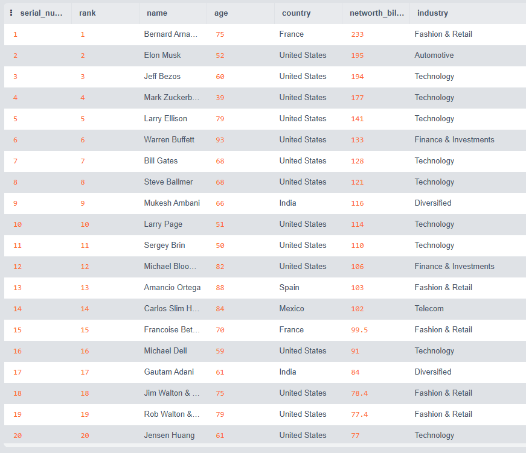
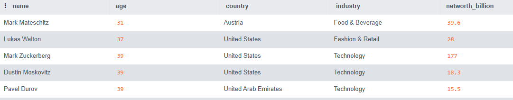

# THE-BILLIONAIRE-WEALTH-INVESTIGATION

# The Billionaire Wealth Investigation (SQL Project)

## Business Scenario
As a Junior Data Analyst at a global financial research organisation, I analysed the world's 200 richest people (Forbes list) using SQL to understand how wealth is distributed by country, industry and age.

## Dataset
Top 200 Richest Person in the World: 200 rows, no missing values.

| Column | Description |
|---|---|
| serial_number | Sequential number |
| rank | Global rank by net worth |
| name | Billionaire's name |
| age | Age |
| country | Country |
| networth_billion_US_dollars | Net worth in billions of US dollars |
| industry | Main source of wealth |

## Tools
MySQL (queries), Excel/Power BI or Python (charts), GitHub (documentation).

## Repository Structure
```
├── README.md
├── dataset/
├── sql/billionaire_queries.sql
├── screenshots/
└── visuals/
```

## Business Questions, Results and Insights

### Q1. 20 richest billionaires


**Insight:** Bernard Arnault ($233B) leads, followed by Elon Musk ($195B) and Jeff Bezos ($194B). 14 of the top 20 are American.

### Q2. Five youngest billionaires


**Insight:** Mark Mateschitz (31) and Lukas Walton (37) are the youngest. Mark Zuckerberg, Dustin Moskovitz and Pavel Durov are tied at 39.

### Q3. Average age and net worth

**Insight:** The average age is 69.4 and the average net worth is $31.84B.

### Q4. Five most represented countries


**Insight:** The US has 79 billionaires, followed by China (17), India (13), Russia (11) and Germany (11).

### Q5. Combined net worth per country


**Insight:** The US holds $3,130.9B, far ahead of France ($478.8B), India ($434.5B) and China ($387.4B).

### Q6. Five industries with the most billionaires


**Insight:** Technology (40), Finance & Investments (32) and Fashion & Retail (30) lead.

### Q7. Countries with at least five billionaires


**Insight:** Only 8 countries qualify: US, China, India, Russia, Germany, Hong Kong, France and Australia.

### Q8. Total wealth of billionaires under 50

**Insight:** 16 billionaires under 50 hold $508.3B combined.

### Q9. Billionaires above the average net worth

**Insight:** 53 of 200 are above the $31.84B average, meaning a few very wealthy individuals pull the average up.

### Q10. Industry with the highest average net worth

**Insight:** Telecom ranks first at $102B, but it has only one billionaire, so the figure is not representative. Technology is next at $43.47B across 40 people.

### Extra A. Age group breakdown
**Insight:** 100 billionaires are aged 60-79 and 49 are 80+. Only 5 are under 40, yet they have the highest average net worth ($55.68B).

### Extra B. Wealth share of the top 10
**Insight:** The top 10 hold 24.37% of the total wealth of the list.
